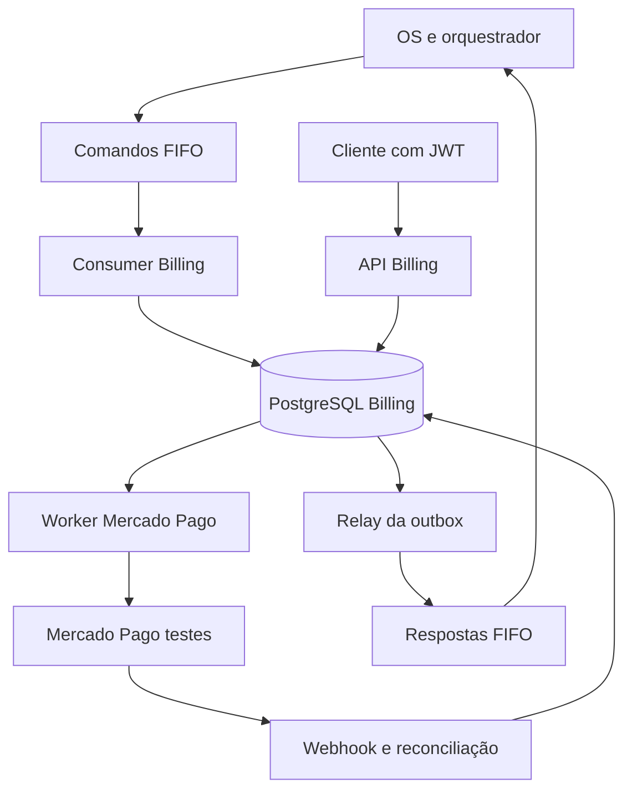

# Arquitetura proposta para o Billing

Estado: desenho inicial de implementação, sem código executável.

## Escolha local

Python 3.11 pela compatibilidade com o grupo; FastAPI para API e OpenAPI; SQLAlchemy
e Alembic para PostgreSQL exclusivo. Não adicionar Redis, Celery, Kafka, Kubernetes
gerenciado ou outro serviço só para o Billing. API, consumer, operações do provedor e
relay podem ser processos separados da mesma imagem e compartilhar apenas o banco Billing.

O OS continua dono da Saga, do status da OS e do estoque que seu código mantém.
Billing não faz GRANT/SQL em banco do OS e não decide quando iniciar execução.

Não é uma transação ACID entre PostgreSQL e Mercado Pago. O worker recupera intenções
persistidas e reconcilia resultados externos usando chaves estáveis.

## Camadas planejadas

| Caminho futuro | Responsabilidade |
|---|---|
| `billing_service/domain/` | Valores, estados, regras de orçamento/pagamento/estorno |
| `billing_service/application/` | Use cases e ports: repositórios, transação, relógio, catálogo, provedor, auth/tracing |
| `billing_service/infrastructure/` | SQLAlchemy, PostgreSQL, HTTP Mercado Pago, boto3 SQS, JWT e logging |
| `billing_service/interfaces/` | Rotas FastAPI, consumer FIFO e comandos CLI dos workers |
| `migrations/`, `tests/`, `k8s/`, `.github/workflows/` | Evolução do banco, validação, deploy e automação |

São caminhos a criar; não executar comandos como se já existissem.

## Modelo de dados inicial

| Entidade | Campos e invariantes principais |
|---|---|
| Orcamento | UUID, sagaId, osId, clienteId, veiculoId, status, total em centavos, validade, commandId de origem e versão |
| ItemOrcamento | Tipo/ID externo/quantidade/preço unitário e subtotal; snapshot imutável da precificação |
| Pagamento | UUID interno, orçamento, valor BRL, estado, chave de operação, ID externo/checkout URL e IDs causadores |
| Estorno | UUID, pagamento, valor, motivo, chave da operação, estado e ID externo quando conhecido |
| Inbox | messageId único, tipo, hash do conteúdo, decisão e data; detecta reutilização do ID com corpo diferente |
| Outbox | envelope e attributes imutáveis, messageId único, destino, ordem por Saga, disponibilidade, tentativas e publicação |
| OperacaoProvedor | Intenção de criar cobrança/estornar, chave idempotente, payload mínimo, lease/estado e próxima tentativa |
| NotificacaoProvedor | Identificador/hash de notificação, estado de verificação e referência ao pagamento; sem dados de cartão |

Referências entre entidades Billing têm FKs locais. IDs de OS/cliente/veículo/serviço/peça
são referências externas, nunca FKs entre bancos. Manter constraints de unicidade por
operação de negócio além do messageId, para reentregas que gerem outro ID por erro do produtor.
Não definir TTL de inbox sem política explícita; deduplicação deve sobreviver a reinícios.

## Consistência e recuperação

1. Validar envelope e atributos; verificar inbox e hash do comando.
2. Em uma transação local, persistir mudança de negócio, inbox e saída/intenção necessária.
3. Só confirmar a mensagem SQS depois do commit durável. O relay recupera saídas pendentes.
4. Relay envia a resposta com o mesmo messageId e corpo em toda tentativa, preservando
   ordem por sagaId. Falha após send permite duplicata; consumidor remoto deduplica.
5. Para Mercado Pago, intenção/chave já existem antes da requisição. Conexão perdida após
   envio produz resultado desconhecido, não nova cobrança nem `PagamentoFalhou` automático.
6. Reconciliar pelo identificador/chave/referência suportados na variante API escolhida.
   Se a API não garante idempotência de uma operação, bloquear retry cego e reconciliar.
7. Concorrência entre aprovação e timeout/cancelamento é resolvida com lock/versão/constraint
   no orçamento. Uma operação não deve reabrir orçamento cancelado ou emitir eventos contraditórios.

## Estados e regras

- Orçamento: aguardando aprovação, aprovado, recusado, cancelado/expirado; validade é verificada
  no Billing mesmo que o timeout global seja disparado pelo OS.
- Pagamento: solicitado/criação pendente, aguardando pagamento, confirmado, falhou, resultado
  desconhecido/em reconciliação. Checkout criado e redirect de sucesso não confirmam dinheiro.
- Estorno: solicitado, processando/desconhecido, confirmado, falha recuperável/intervenção.
  Só emitir `PagamentoEstornado` quando o provedor confirmar o estorno.
- Não misturar ID interno UUID com identificador de pagamento/ordem do Mercado Pago.
- Conferir valor, moeda, referência externa e vínculo ao orçamento antes de confirmar pagamento.
- O contrato permite orçamento zero, mas pagamento exige valor positivo: política de orçamento
  gratuito permanece pendente. Não inventar pagamento simbólico nem mudar schema sozinho.
- O fluxo após falha e posterior aprovação tardia de pagamento exige reconciliação/compensação
  acordada; nunca simplesmente descartar uma cobrança que apareceu fora de ordem.

## JWT e webhook

API cliente valida assinatura RS256, emissor/audiência/expiração/claims e ownership local
do orçamento. O Billing recebe apenas chave pública, não a chave privada do emissor.
Perfil atendente só após contrato de identidade aprovado.
Webhook usa assinatura do Mercado Pago e consulta autenticada ao provedor; não JWT cliente.
Consumer SQS usa identidade/permissões da mensageria, não token JWT dentro do envelope.

Tracing W3C preserva atributos no inbox/outbox; logs incluem IDs e resultado, sem tokens,
CPF, cartões, URL completa de checkout, credenciais ou corpos sensíveis.
